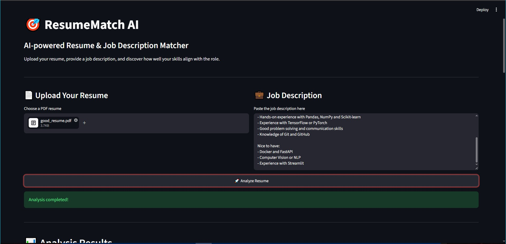
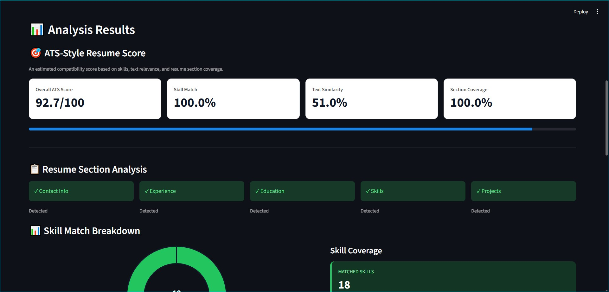
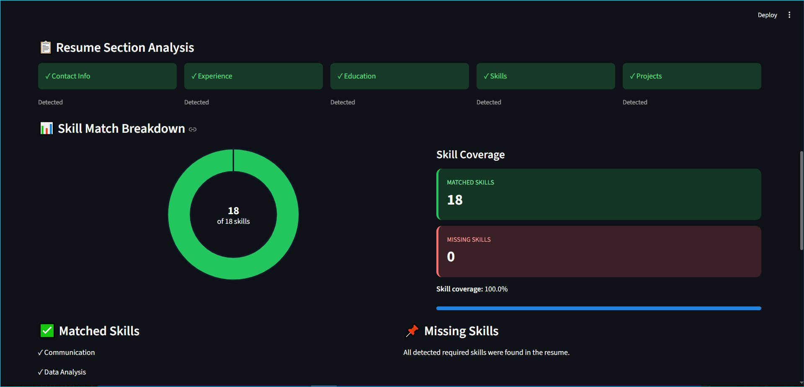

# 🎯 ResumeMatch AI

An AI-powered web app that compares your **resume (PDF)** with a **job description** and gives an **ATS-style score**, a skill gap report and simple tips to improve your resume.

> ⚠️ **Note:** Real ATS tools (Workday, Taleo, Greenhouse, etc.) do not share their formulas. This score is a clear, rule-based **estimate**. It is not an official ATS score and it does not predict hiring results.

---

## 📸 Screenshots

### Results overview


### Resume section and skill analysis


### Matched skills, missing skills and suggestions


---

## ✨ Features

- 📄 Upload a PDF resume and read its text automatically
- 💼 Paste any job description
- 🎯 Overall ATS-style score out of 100
- ✅ Matched skills and 📌 missing skills (required skills count more than "nice to have" skills)
- 📋 Resume section check (Contact, Experience, Education, Skills, Projects)
- 📊 Skill match chart
- 💡 Personal improvement suggestions

---

## 🧮 How the score is calculated

| Part | Weight | What it checks |
|------|--------|----------------|
| Skill match | 45% | Skills from the job description found in the resume. Required skills count fully, "nice to have" skills count half. |
| Text similarity | 15% | How close the resume text is to the job description (TF-IDF + cosine similarity). |
| Section coverage | 15% | Standard sections: Contact Info, Experience, Education, Skills, Projects. |
| Impact | 15% | Bullet points that start with action words and include numbers (like "reduced errors by 20%"). |
| Format | 10% | Email, phone, dates, bullet points, resume length and unusual symbols. |

You can change the weights in `scorer.py` (`WEIGHTS`).

---

## 🛠️ Tech stack

- Python
- Streamlit (web app)
- PyMuPDF (PDF reading)
- Scikit-learn (text similarity)
- Plotly (charts)

---

## 🚀 How to run

```bash
# 1. Clone the project
git clone https://github.com/YOUR_USERNAME/ResumeMatch-AI.git
cd ResumeMatch-AI

# 2. Install packages
pip install -r requirements.txt

# 3. Start the app
streamlit run app.py
```

---

## 🧪 Try it with the sample files

1. Run the app.
2. Upload `good_resume.pdf`.
3. Paste this job description:

```
AI/ML Intern

We are looking for an AI/ML intern to join our team in Noida.

Requirements:
- Strong knowledge of Python and SQL
- Experience with Machine Learning and data analysis
- Hands-on experience with Pandas, NumPy and Scikit-learn
- Experience with TensorFlow or PyTorch
- Good problem solving and communication skills
- Knowledge of Git and GitHub

Nice to have:
- Docker and FastAPI
- Computer Vision or NLP
- Experience with Streamlit
```

This sample resume scores about **93/100**. Try removing some skills from the resume or the job description to see the score go down.

---

## 📁 Project files

| File | Purpose |
|------|---------|
| `app.py` | Streamlit web app |
| `pdf_parser.py` | Reads text from the PDF resume |
| `skill_extractor.py` | Finds skills (150+ skills with aliases) and splits required / preferred skills |
| `matcher.py` | Compares resume skills with job skills |
| `scorer.py` | Calculates the final ATS-style score and suggestions |
| `test_*.py` | Simple test scripts for each part |
| `good_resume.pdf` | Sample resume with a high score |
| `sample_resume.pdf` | Sample resume for the parser test |

Run a test with, for example: `python test_scorer.py`

---

## ⚠️ Limitations

- Only skills in the list inside `skill_extractor.py` are found. You can add more.
- Only the text of the PDF is read. Tables, columns and images are not checked.
- Scanned PDFs (images) are not supported.

---

## 🔮 Future ideas

- Support more skills and job titles
- Support DOCX resumes
- Add OCR for scanned resumes
- Suggest better wording for bullet points

---

Built by **Abhay** as part of a portfolio for AI/ML internships.
